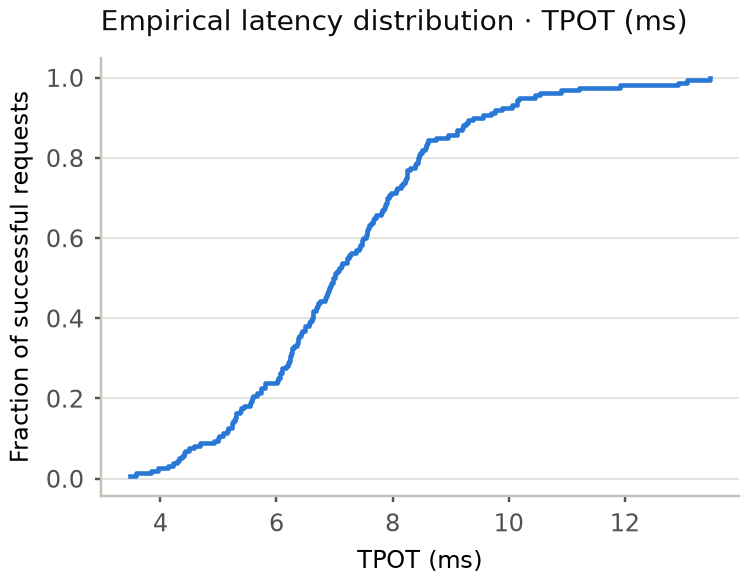
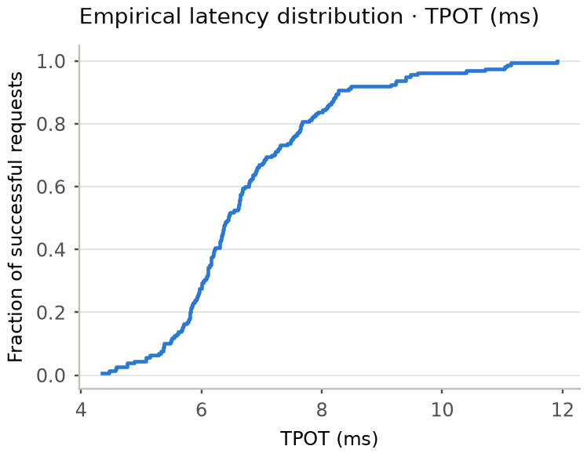
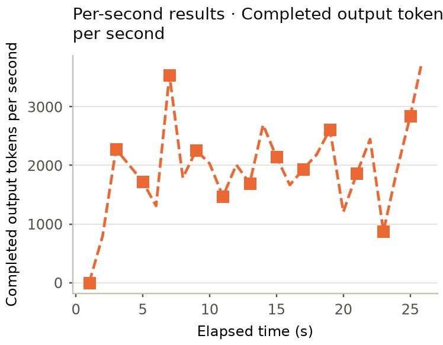
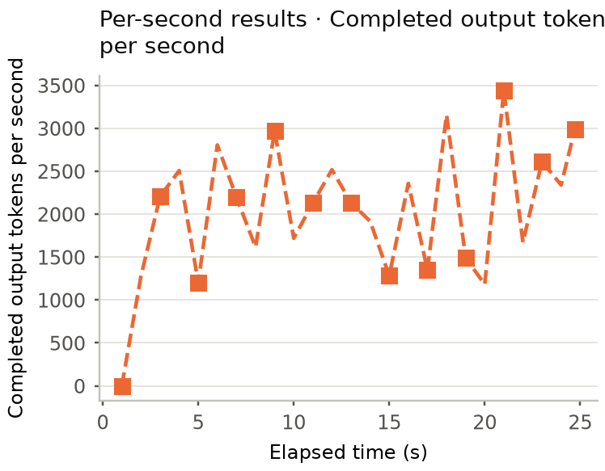

<!-- SPDX-License-Identifier: Apache-2.0 -->
<!-- SPDX-FileCopyrightText: Copyright contributors to the Foretoken project -->

# Qwen MetaX：实验结论

## 状态与目标

本实验在两个各有8张MetaX C500的节点A、B上，以K3s部署Qwen3.5-35B-A3B BF16，比较并发1的解码延迟与并发16的总输出吞吐。Foretoken基线为 `c42a9f3f`，引擎为vLLM0.31。预定24小时上限为2026-10-13 02:21:40至2026-10-14 02:21:40（UTC+08:00）；本轮测量收敛后于10月13日14:34:48释放全部运行资源，14:52:58完成磁盘清理。

当前保留greedy采样优化与active_request＋max路由。greedy同源码绑定的on-off-on对照中，确认轮random吞吐提高1.8614%／3.2375%，TPOT降低2.0554%／5.1769%；路由在完全相同实例的c16反转确认中，吞吐提高4.3826%、TPOT降低5.2743%。四TP2组合与单TP4的random、StudyChat两并发验证均已完成：前者适合总吞吐，后者提供更低的单并发TPOT，设备成本不同。四副本前缀缓存降低TTFT，但c16总吞吐近乎不变。预算8192、TP8、KV-aware路由与stats增量未纳入保留方案。本轮可实测候选已收敛，停止新增重复测量；质量评估未执行，运行资源与任务磁盘清理均已验收。

## 对照条件

TP表示每个模型实例的张量并行卡数；例如四个TP2副本共使用8 GPU，但单个请求由一个两卡实例执行。参考配置为TP2、BF16、三步MTP、V2 runner、异步调度、4096 token批量预算、分片采样、maxseq16及36864上下文，关闭前缀缓存与共享专家辅助流。

greedy对照仅切换两个采样Python文件，保留同core源码绑定、19项适配、环境镜像、运行接口及四TP2布局；应用revision随代码发布改变，各窗口运行身份稳定。旧环境结果单列，算法比较使用同绑定off参考。NVMe方案迁移完整RuntimeCache（含权重副本），保留原卷，模型及精度不变；它们用于新存储环境参考。所有运行保留真实命令、配置、来源和原始产物。

## 已完成的random结果

每组160条正式请求及4条预热，seed0、temperature0，输入128–4096／输出128–512配置不变。吞吐为服务总输出，TPOT为平均ms/token；CLI等待、绘图、上传不计入正式测量。

| 节点／方案 | GPU | c1输出token/s／TPOT | c16输出token/s／TPOT | 当前结论 |
| --- | ---: | --- | --- | --- |
| A：参考TP2 | 2 | 214.134576／4.085970 | 922.947578／15.783188 | 节点A参考 |
| B：参考TP2 | 2 | 219.183820／4.005026 | 948.905330／15.509068 | 节点B参考 |
| A：预算8192 | 2 | 218.389165／4.008588 | 924.052460／15.500153 | c16吞吐+0.12%，暂不保留；换卡条件仍记录 |
| B：TP4 | 4 | 235.179758／3.732080 | 1162.754155／12.595895 | 对B参考总吞吐+7.30%／+22.54%，TPOT−6.82%／−18.78%；不是同设备成本收益 |
| A：两个TP2副本 | 4 | 219.152835／4.009539 | 1380.439125／10.307421 | 对A参考c16总吞吐+49.57%、TPOT−34.69%，设备成本增加 |
| A：四个TP2副本 | 8 | 216.648950／4.049931 | 1882.845038／7.357524 | 对前一4卡布局c16吞吐+36.39%、TPOT−28.62% |
| B：两个TP4副本 | 8 | 232.680882／3.798124 | 1615.185056／8.836094 | 对前一4卡布局c16吞吐+38.91%、TPOT−29.85% |
| A：greedy首次开启，四TP2 | 8 | 220.649480／3.967065 | 1974.477779／7.080554 | 对同绑定off吞吐+2.0666%／+5.4648%，TPOT−2.0028%／−5.7750% |
| A：同绑定greedy关闭参考 | 8 | 216.181891／4.048142 | 1872.166997／7.514515 | 保留同环境与源码绑定，仅逆转两采样文件 |
| A：greedy再次开启确认 | 8 | 220.205894／3.964936 | 1932.777709／7.125499 | 对off吞吐+1.8614%／+3.2375%，TPOT−2.0554%／−5.1769% |
| A：active-request路由 | 8 | 223.356168／3.943421 | 2033.140410／6.812189 | 对greedy确认吞吐+1.4306%／+5.1927%，TPOT−0.5426%／−4.3970% |
| A：回退原路由确认 | 8 | — | 1946.831319／7.170942 | 仅c16，保持相同实例与源码 |
| A：恢复active路由确认 | 8 | — | 2032.152743／6.792728 | 对回退吞吐+4.3826%、TPOT−5.2743%；保留active＋max |
| B：TP8，NVMe RuntimeCache | 8 | 224.854113／3.912317 | 1164.200567／12.312046 | 对同机TP4 c16吞吐+0.124%，每GPU约减半，c1更慢；排除TP8 |
| B：恢复TP4，NVMe RuntimeCache | 4 | 236.191970／3.708031 | 1158.817389／12.608798 | 对旧TP4吞吐+0.4304%／−0.3386%，作为新环境参考，不宣称NVMe decode收益 |
| B：resample新绑定TP4参考 | 4 | 240.074954／3.653873 | 1197.436070／12.219401 | stats前参考；与旧绑定／卡组仅作观察比较 |
| B：stats TP4初筛 | 4 | 241.104331／3.647387 | 1184.590540／12.275672 | 与首参考卡组不同，另补同卡组参考 |
| B：同卡组撤stats参考 | 4 | 237.327650／3.683172 | 1161.235057／12.602465 | stats单次改善约1%–2%，逐请求变化分散且响应不同，暂不保留增量 |
| A：恢复后prefix，顺序运行 | 8 | 216.050006／3.961643 | 1918.228268／7.158966 | 有实际复用，旧c16为热缓存条件 |
| A：fresh prefix c16 | 8 | — | 1845.903752／7.298355 | 正式与预热cached0，对本周期off吞吐−5.2349%、TPOT+6.6386% |
| A：本周期cache-off c16参考 | 8 | — | 1947.872207／6.844009 | 正式与预热cached0，恢复cohort边界保留 |
| B：greedy＋active双TP4 | 8 | 243.231710／3.617309 | 1609.718412／8.824845 | 完成布局候选；c16未超过四TP2，未独立保留 |

TP4每GPU吞吐为58.794940／290.688539，较本节点TP2参考下降46.35%／38.73%。双TP2每GPU吞吐为54.788209／345.109781，较其本节点参考下降48.83%／25.22%。这些是历史资源布局初筛，不列为已完成最终验收的保留组合；c1一次请求仍只使用一个TP2副本。两布局跨节点且总CPU／memory声明不同，当前仅作布局初筛，不作为严格同资源因果对照。8卡布局继续改善c16总吞吐，但对初始2卡基准，每GPU吞吐仍下降49.00%／57.45%；四TP2还将每实例CPU由16／24调至8／12，需要按实际分配整体解释。

on-off-on三组均通过逐请求审核。确认轮正式窗口为228.150115／25.993677秒；c1有153／160个配对请求TPOT降低，平均差−0.083206ms。c16接受率估计为off 0.867971、首次on 0.844206、确认on 0.847206；这些是正式窗口内当前实例counter增量估计，改善不能全部分解为直接resample耗时。

active-request使用现有本地在途请求计分与max选择，四Group／模型Pod及frontend身份均与greedy确认完全一致。c1的tie选择固定卡对，收益包含实例选择因素；c16正式24.710541秒，实际并发峰值16／均值15.288523。仅c16反转已完成，恢复active吞吐与首次active相差−0.0486%，全程模型/frontend UID不变，方向复现。

恢复后顺序prefix random c1／c16缓存输入为4288／37520（每组输入343782），旧c16预热也复用2144tokens，不能与fresh零hit混用。本周期fresh on/off均cached0，prefix增加无复用负载开销，故仅作为特定TTFT需求的可选项。恢复frontend的restartCount前后均1、UID/container一致，窗口无重启；新cohort与时间条件单独保留。

### 路由反转原生图

同一批模型与frontend实例，配置并发16，每组160正式请求＋4预热；左列为回退原路由，右列为恢复active＋max。原图保留各自自动坐标范围，比较时应读取轴值。TPOT经验分布描述成功请求；时间曲线将请求输出计入其完成时刻的一秒窗口，不是实时流式decode速率。全窗口吞吐对应上表1946.831319／2032.152743token/s。

| 原路由参考 | active＋max |
| --- | --- |
|  |  |
|  |  |

## 已完成的StudyChat对话结果

每组128条正式HTTP turns来自14段对话，4条预热；每个并发组前重启至fresh KV／recurrent state，保留权重与编译缓存。113轮采用参考目标强制定长，15轮为普通2048输出上限；实际输出长度可能不同。对话吞吐不与random混比。

| 节点／方案 | GPU | 配置并发 | 成功HTTP turns／对话 | 输出token/s | TPOT ms/token | 实际请求并发peak／mean | 正式秒数 |
| --- | ---: | ---: | --- | ---: | ---: | --- | ---: |
| A：四TP2副本，cache-off | 8 | 1 | 128／14 | 184.650574 | 4.656178 | 1／0.999697 | 364.618417 |
| A：四TP2副本，cache-off | 8 | 16 | 128／14 | 854.959822 | 7.566068 | 14／6.357028 | 77.389602 |
| B：单TP2，cache-off | 2 | 1 | 128／14 | 190.797386 | 4.517068 | 1／0.999635 | 352.871711 |
| B：单TP2，cache-off | 2 | 16 | 128／14 | 561.008503 | 12.704269 | 14／6.674760 | 118.590003 |
| B：单TP2，prefix-align | 2 | 1 | 128／14 | 194.602490 | 4.689255 | 1／0.999681 | 345.180579 |
| B：单TP2，prefix-align | 2 | 16 | 128／14 | 660.754339 | 11.496119 | 14／6.941107 | 99.648230 |
| B：TP4，NVMe，cache-off | 4 | 1 | 128／14 | 210.553051 | 4.216334 | 1／0.999664 | 319.748395 |
| B：TP4，NVMe，cache-off | 4 | 16 | 128／14 | 692.346842 | 12.214523 | 14／6.935681 | 97.045290 |
| A：greedy＋active路由，cache-off | 8 | 1 | 128／14 | 190.604609 | 4.502095 | 1／0.999669 | 353.228604 |
| A：greedy＋active路由，cache-off | 8 | 16 | 128／14 | 946.911911 | 6.517889 | 14／6.393901 | 71.218874 |
| A：prefix-align＋active | 8 | 1 | 128／14 | 199.379416 | 4.545437 | 1／0.999632 | 336.288477 |
| A：prefix-align＋active | 8 | 16 | 128／14 | 948.747199 | 6.493285 | 14／6.218852 | 71.146455 |
| A：prefix-align＋KV-aware | 8 | 1 | 128／14 | 197.276912 | 4.569100 | 1／0.999692 | 342.168778 |
| A：prefix-align＋KV-aware | 8 | 16 | 128／14 | 856.572391 | 6.898362 | 14／6.263275 | 76.668359 |
| B：TP4，greedy保留源码，cache-off | 4 | 1 | 128／14 | 213.075442 | 4.104996 | 1／0.999645 | 305.567828 |
| B：TP4，greedy保留源码，cache-off | 4 | 16 | 128／14 | 724.668762 | 11.958481 | 14／7.134255 | 92.897616 |
| B：greedy＋active双TP4，cache-off | 8 | 1 | 128／14 | 216.208974 | 4.070429 | 1／0.999630 | 308.988100 |
| B：greedy＋active双TP4，cache-off | 8 | 16 | 128／14 | 901.611849 | 8.029591 | 14／6.633888 | 74.020766 |

样本只有14段因果对话，配置并发16的实际峰值为14。B prefix-align c1的缓存输入比例63.55%，TTFT下降46.29%、吞吐+1.99%，TPOT+3.81%；c16缓存比例59.44%，吞吐+17.78%、TPOT−9.51%、TTFT−34.08%，45次正缓存命中。该服务使用原运行环境，未应用节点A的greedy源码。独立请求审核通过，输出差异另见下节。

对话W&B：A [c1](https://wandb.ai/shi609587797/foretoken-bench/runs/bpn8kg6c)／[c16](https://wandb.ai/shi609587797/foretoken-bench/runs/eia64abv)，B [c1](https://wandb.ai/shi609587797/foretoken-bench/runs/whyabti4)／[c16](https://wandb.ai/shi609587797/foretoken-bench/runs/m1szf650)。四个off SDK成功结束，每run56张非空PNG；B prefix-align [c1](https://wandb.ai/shi609587797/foretoken-bench/runs/e2mbgpir)／[c16](https://wandb.ai/shi609587797/foretoken-bench/runs/oadbpf9w)亦成功结束，每组57张非空PNG。完整原始记录与命令保留。

B TP4相对同机TP2-off的c1／c16总吞吐+10.3543%／+23.4111%，TPOT−6.6577%／−3.8550%；GPU从2增至4、存储与进程状态不同，属于布局扩展。两组各自fresh-engine且请求审核通过，c16每GPU输出173.086710。实际W&B：[c1](https://wandb.ai/shi609587797/foretoken-bench/runs/0ui0qzfl)／[c16](https://wandb.ai/shi609587797/foretoken-bench/runs/aamd6g9h)，两SDK成功结束，各60张非空PNG。

A保留组合两组均已完成、独立审核通过，对旧四TP2-off吞吐+3.2245%／+10.7551%，TPOT−3.3092%／−13.8537%；组合改变源码与路由，属于组合观察。实际W&B：[c1](https://wandb.ai/shi609587797/foretoken-bench/runs/b67rvgaf)／[c16](https://wandb.ai/shi609587797/foretoken-bench/runs/xdq5uinq)，两SDK成功结束、各56张非空PNG。

A prefix-align＋active两组均完成且独立审核通过。c1缓存比例63.5543%、吞吐+4.6037%、TPOT+0.9627%、TTFT−45.3150%；c16为42次命中／244416缓存tokens（46.8944%）、吞吐+0.1938%、TPOT−0.3775%、TTFT−22.1260%。两组预热缓存均0，四副本c16吞吐收益接近零。实际W&B：[c1](https://wandb.ai/shi609587797/foretoken-bench/runs/j238mbew)／[c16](https://wandb.ai/shi609587797/foretoken-bench/runs/n4wk2aze)，SDK成功结束、各57张PNG，source2b保持。

## 输出差异与质量状态

质量评估尚未执行，性能与请求契约通过不能建立答案质量等价。greedy三组c1输出choices完全一致；相对同绑定off，首次on与确认on的c16分别有90／87个正式、各2个预热choice差异（首次on对旧环境为93／2）。TP4-NVMe c1与旧TP4一致，c16为91／3差异；TP8相对旧TP4 c1为136／4、c16为127／3差异，强制长度均匹配。active-request相对greedy确认c1一致，c16为86个正式／1个预热choice差异；路由恢复对回退为92／1差异。TP4 StudyChat相对TP2-off可见final差异26／23，结束原因差异3／0，实际总输出67324／67189。A新组合StudyChat c1可见final与旧四TP2-off一致；c16有31个final／2个finish差异，实际输出67438对旧66165，普通预算工作量差异保留。

prefix-align的普通预算轮输出工作不同：c1总输出off/on 67327／67173，9个长度差异、26个可见final差异、2次stop／length转换；c16为66530／65843，10个长度差异、25个final差异、3次转换。A prefix-active c1输出67049对off67327，27个final／5个finish差异；c16为67500对67438，31／2差异。stats TP4对新绑定参考choice差异c1为101正式／4预热、c16为104／4，伴随卡组改变。113个强制目标轮均满足长度。默认不展示解析出的reasoning，因此role-only响应本身不构成质量失败；原生TTFT也不必然是首个可见文本token。

## 随机负载结果访问

| 方案 | 并发1 | 并发16 |
| --- | --- | --- |
| A：参考TP2 | [W&B](https://wandb.ai/shi609587797/foretoken-bench/runs/cj8gc5wj) | [W&B](https://wandb.ai/shi609587797/foretoken-bench/runs/5d87o9fo) |
| B：参考TP2 | [W&B](https://wandb.ai/shi609587797/foretoken-bench/runs/negr5elc) | [W&B](https://wandb.ai/shi609587797/foretoken-bench/runs/atp7mrth) |
| A：预算8192 | [W&B](https://wandb.ai/shi609587797/foretoken-bench/runs/i1mhj8fm) | [W&B](https://wandb.ai/shi609587797/foretoken-bench/runs/2vauss2o) |
| B：TP4 | [W&B](https://wandb.ai/shi609587797/foretoken-bench/runs/w9kyw6qd) | [W&B](https://wandb.ai/shi609587797/foretoken-bench/runs/3gt47ok1) |
| A：两个TP2副本 | [W&B](https://wandb.ai/shi609587797/foretoken-bench/runs/4muxy5xj) | [W&B](https://wandb.ai/shi609587797/foretoken-bench/runs/7xgmbt1z) |
| A：四个TP2副本 | [W&B](https://wandb.ai/shi609587797/foretoken-bench/runs/ay0hcsqe) | [W&B](https://wandb.ai/shi609587797/foretoken-bench/runs/ulvgixpe) |
| B：两个TP4副本 | [W&B](https://wandb.ai/shi609587797/foretoken-bench/runs/rcyzr24j) | [W&B](https://wandb.ai/shi609587797/foretoken-bench/runs/9e6l0o5b) |
| A：新core采样候选，四TP2 | [W&B](https://wandb.ai/shi609587797/foretoken-bench/runs/tt72yzx2) | [W&B](https://wandb.ai/shi609587797/foretoken-bench/runs/q9cm67hb) |
| B：TP8，NVMe RuntimeCache | [W&B](https://wandb.ai/shi609587797/foretoken-bench/runs/d1wijqqd) | [W&B](https://wandb.ai/shi609587797/foretoken-bench/runs/96g2cwk2) |
| A：同binding采样off参考 | [W&B](https://wandb.ai/shi609587797/foretoken-bench/runs/706oxzw5) | [W&B](https://wandb.ai/shi609587797/foretoken-bench/runs/ifffu2qz) |
| B：恢复TP4，NVMe RuntimeCache | [W&B](https://wandb.ai/shi609587797/foretoken-bench/runs/i38g3cg7) | [W&B](https://wandb.ai/shi609587797/foretoken-bench/runs/1thvwduq) |
| A：greedy再次开启确认 | [W&B](https://wandb.ai/shi609587797/foretoken-bench/runs/i364w7v7) | [W&B](https://wandb.ai/shi609587797/foretoken-bench/runs/0wm2g5gr) |
| A：active-request路由 | [W&B](https://wandb.ai/shi609587797/foretoken-bench/runs/lhuj79is) | [W&B](https://wandb.ai/shi609587797/foretoken-bench/runs/s34wa594) |
| A：回退原路由确认 | — | [W&B](https://wandb.ai/shi609587797/foretoken-bench/runs/2eew5m5o) |
| A：恢复active路由确认 | — | [W&B](https://wandb.ai/shi609587797/foretoken-bench/runs/a6v66uwd) |
| B：resample新绑定TP4参考 | [W&B](https://wandb.ai/shi609587797/foretoken-bench/runs/83l6k7ao) | [W&B](https://wandb.ai/shi609587797/foretoken-bench/runs/xt0i8ekz) |
| B：stats TP4初筛 | [W&B](https://wandb.ai/shi609587797/foretoken-bench/runs/xrjzsf23) | [W&B](https://wandb.ai/shi609587797/foretoken-bench/runs/ylouelp9) |
| B：同卡组撤stats参考 | [W&B](https://wandb.ai/shi609587797/foretoken-bench/runs/ucjr4c59) | [W&B](https://wandb.ai/shi609587797/foretoken-bench/runs/6ea34ago) |
| A：恢复后prefix，顺序运行 | [W&B](https://wandb.ai/shi609587797/foretoken-bench/runs/xa6kxqfe) | [W&B](https://wandb.ai/shi609587797/foretoken-bench/runs/zms97ho5) |
| A：fresh prefix c16 | — | [W&B](https://wandb.ai/shi609587797/foretoken-bench/runs/jn9edece) |
| A：本周期cache-off参考 | — | [W&B](https://wandb.ai/shi609587797/foretoken-bench/runs/ts2f4r85) |
| B：greedy＋active双TP4 | [W&B](https://wandb.ai/shi609587797/foretoken-bench/runs/4qo4jlcw) | [W&B](https://wandb.ai/shi609587797/foretoken-bench/runs/9jypwpx7) |

后期StudyChat：KV-aware [c1](https://wandb.ai/shi609587797/foretoken-bench/runs/oxj1a197)／[c16](https://wandb.ai/shi609587797/foretoken-bench/runs/k2ej5ara)；保留TP4源码 [c1](https://wandb.ai/shi609587797/foretoken-bench/runs/iwilxfr1)／[c16](https://wandb.ai/shi609587797/foretoken-bench/runs/80d0cvsg)。链接身份来自各实际SDK运行目录。新双TP4对话：[c1 imdh1lpf](https://wandb.ai/shi609587797/foretoken-bench/runs/imdh1lpf)／[c16 k4eitm7e](https://wandb.ai/shi609587797/foretoken-bench/runs/k4eitm7e)。c1生成及本地结果完整，随后云发布失败使原context仍为failed1；owner对同run官方sync成功。c16在线初始化超时未产生请求，后续task offline run完成128＋4，再由官方sync成功送达原ID；未重跑c1或覆盖失败记录。

各run保留实际命令、配置、环境、正式与预热响应、原生metrics、时间曲线和请求顺序图。已完成运行的原始图表保持不变；指标观察器修复只影响同步之后的新测量，已完成的两种8卡布局c1提供实际多副本E2E验证。

## 复现保留改动

保留的[greedy resample patch](patches/greedy-resample.patch)针对官方core [`db9527a46873454610df6dbedf79a36d6bf1a7f6`](https://github.com/vllm-project/vllm/tree/db9527a46873454610df6dbedf79a36d6bf1a7f6)，显式应用于独立checkout，不属于自动补丁series。以下从Foretoken仓库根目录执行；先将`SERVICE`设为已有模型服务的Kustomize目录，安装时沿用原有runtime、registry及values选择。

```bash
git clone https://github.com/vllm-project/vllm.git ../vllm-rsi
git -C ../vllm-rsi checkout --detach db9527a46873454610df6dbedf79a36d6bf1a7f6
PATCH="$(pwd)/rsi-playbooks/tasks/qwen-decode/2026-10-13-metax-k3s/patches/greedy-resample.patch"
git -C ../vllm-rsi apply --check "$PATCH"
git -C ../vllm-rsi apply "$PATCH"
foretoken install -e . --engine-source ../vllm-rsi
foretoken deploy "$SERVICE"
```

撤销增量后，用同一部署命令更新原服务：

```bash
git -C ../vllm-rsi apply --reverse --check "$PATCH"
git -C ../vllm-rsi apply --reverse "$PATCH"
foretoken deploy "$SERVICE"
```

MetaX复现需匹配0.31运行时、设备ABI及既有适配；干净core＋此patch只重现代码增量，不等同本轮完整镜像。默认MetaX SDK组合仍选0.30 core，未自动提供本实验patch。环境与core/plugin绑定沿用[从源码部署](../../../../docs/custom-deployment_zh.md#修改推理引擎)，无需另建实验配置。公开交付只包含保留的resample增量，stats已撤除。

## 系统路径验证

| 问题 | 当前状态 | 实际验证范围 |
| --- | --- | --- |
| 本地tokenizer定位 | 修复仍仅本地 | 旧失败复现与独立CPU请求准备成功；正式perf显式指定路径 |
| Cargo官方源重复注册 | 修复仍仅本地 | 禁网cargo check旧失败、修复配置成功；未验证下载 |
| Prometheus旧实例曲线混入 | 后续采集已应用修复 | 历史API对照及两种8卡布局c1多副本E2E；旧曲线保留 |
| MetaX SDK补丁版本选择 | 已进入0.31 core-only安装 | 安装exit0、未触发插件native构建，后续模型Ready与random完成 |
| 源码占位文件导出 | 修复已发布 | 新manifest、四init退出0、模型Ready及正式测量 |
| 零容量部署等待 | 产品修复未实现 | 正常drain与资源退出已观察，CLI等待及后续生命周期缺口记录在内部资料 |
| NFS编译缓存ESTALE | 本轮以完整RuntimeCache本地化恢复 | 原卷保留，TP8／TP4-NVMe完成；新存储参考见上表 |
| 显式目录owner提交时丢失 | producer已修复 | 非k3d绝对node目录保留声明；隔离两次apply的RC/PVC/PV身份稳定、Ready/Bound及清理通过；未替换测量客户端 |
| profile子目录组写不足 | taskcache组写／setgid恢复 | 原EACCES及temporary条件保留；producer修复不等同全部profile／运行UID端到端通过 |

独立GDN BV64/BV16均未保留，原BV32继续使用。stats单GPU诊断和完整模型对照均已完成，增量已撤除；其微诊断耗时改善不代表相同比例的端到端收益。KV-aware路由在四副本c16中吞吐降低9.715%、TPOT增加6.238%，已恢复active_request＋max。

原生15秒profile的API仍为Failed／RuntimeUnreachable、完成1／4参与者；后续四runtime为1 Succeeded／3 Cancelled，均已导出，8 trace＋4 manifest约7.39GB稳定且worker停止。它们仅用于各自capture区间分析。八rank摘要中resample＋insert占GPU事件跨度低于0.08%，stats低于0.85%；主要热点为原生GEMM／MoE、通信及GDN。继续优化需相应上游诊断与内核工具，本轮停止重复测量，不将profile下的事件占比写成正式吞吐收益或全局性能上限。

## 执行效率与验收状态

最终逐个重审59个context：57条命令退出0，58组原生完整测量（40 random、18 StudyChat），重审问题0。两条命令失败分别是生成完成后的W&B发布失败、SDK初始化超时且未发请求；原失败记录保留。前者由官方sync恢复交付，后续离线c16也完成同ID同步，没有重跑生成；profile诊断另计，不混入测量数量。

最终资源统计区间为2026-10-13 02:21:40至14:34:48.091160，共43988.091秒，覆盖暂停与恢复后的原任务窗口。

| 节点 | GPU池 | 采样覆盖率 | 已覆盖时段平均池利用率 | 运行资源释放 |
| --- | ---: | ---: | ---: | --- |
| A | 8卡 | 85.2574% | 2.0563% | 14:33:51 |
| B | 8卡 | 85.3722% | 2.6557% | 14:34:48 |

停采和API中断缺口保持未知、不计为零；Agent启动／完成历史不完整，时间加权Agent均值不可核验。11:53曾停止，13:10按用户要求恢复，13:13续采；最后采集器14:35:20／21正常停止，PID与tmux退出。

全部模型／Group已正常drain，两套任务容器退出；A于14:42:48、B于14:52:58完成精确任务NVMe目录及DIND删除，原生设备查询无GPU进程。trace、源码、raw和原模型数据已持久保全，磁盘清理时点不混入GPU资源占用统计。

停止前严格计9个完整random候选＋3个仅StudyChat prefix候选，恢复后既有prefix补测不新增轮次，新双TP4组合增加1；宽计13仍不足20。按任务额度未新增质量评估，不用请求成功或长度一致替代质量结论。本轮可验证候选已收敛，停止重复测量；剩余原生热点需对应上游诊断与内核工具，结束原因不是24小时上限用尽，也不代表全局性能空间耗尽。
